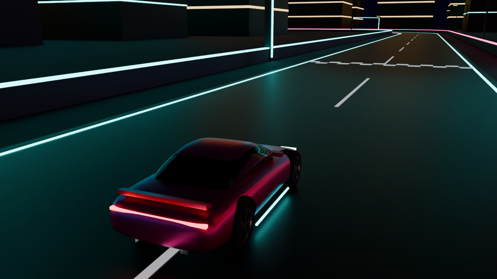

# MIDNIGHT REIGN

An original open-world street racing game. Unreal Engine 5 (C++ and Blueprints, Chaos Vehicles),
Blender for assets, and the original Pygame prototype kept as the gameplay reference.

## Status — Milestone 1: driving prototype

| Part | Where | State |
|---|---|---|
| Original Pygame prototype | `prototype/python/midnight_street_racer.py` | Preserved unchanged |
| Frame-rate-independent Python port + nitrous tank | `prototype/python/reign_sim` | Tested (`pytest`) |
| Engine-independent C++ core (nitrous, steering, arcade model) | `core/` | Tested (`ctest`) |
| Unreal project: vehicle pawn, nitrous, chase camera, input, HUD | `unreal/MidnightReign` | **Written, not yet compiled or driven** — needs your Unreal Editor |
| Starter car, customization parts, Solaris Coast test block (FBX) | `assets/export`, built by `blender/` | Generated, rendered and tested (`pytest blender/tests`) |
| Unreal import script: materials, vehicle Blueprint, tuning asset, test map | `unreal/MidnightReign/Scripts/setup_visuals.py` | **Written, not yet run** — needs your Unreal Editor |

The Unreal code and import script were written without access to Unreal Editor. Treat them as
unverified until they have been compiled and run on your machine.



## Run the tests

```bash
cmake -S core -B build && cmake --build build && ctest --test-dir build --output-on-failure
```

```bash
pip install pytest && pytest prototype/python
```

```bash
pip install bpy pytest && python3 blender/build_all.py && pytest blender/tests
```

## Open the game

1. Install Unreal Engine 5.6 or newer with C++ build tools (Visual Studio 2022 on Windows, Xcode on Mac).
2. Right-click `unreal/MidnightReign/MidnightReign.uproject` → *Generate project files*
   (use *Switch Unreal Engine version* first if you are not on 5.6).
3. Open the `.uproject` and let it compile.
4. Follow `docs/editor-setup.md`: run the visual setup script, do the two short manual steps, press Play.

## Layout

```
prototype/python/   original prototype + tested per-second port
core/               header-only C++17 gameplay maths, no Unreal dependency, unit tested
blender/            scripts that generate the car, parts and track; asset tests
assets/export/      generated FBX files and manifests
unreal/MidnightReign/  Unreal project (module includes core/include)
docs/               mapping from prototype to UE5, editor steps, roadmap
```

## Docs

- `docs/python-to-ue5-mapping.md` — how each prototype mechanic maps to Unreal
- `docs/systems.md` — the systems added in Milestone 1 and how they fit together
- `docs/art-pipeline.md` — Blender → Unreal conventions and preview renders
- `docs/editor-setup.md` — the steps that need Unreal Editor
- `docs/roadmap.md` — milestones 2–6 and what can be done where
