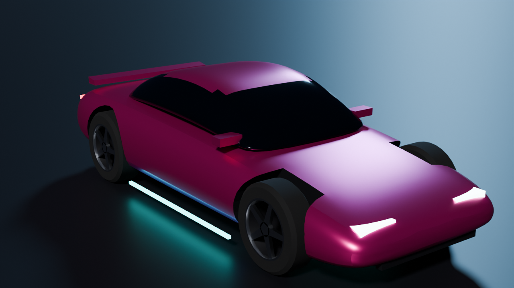
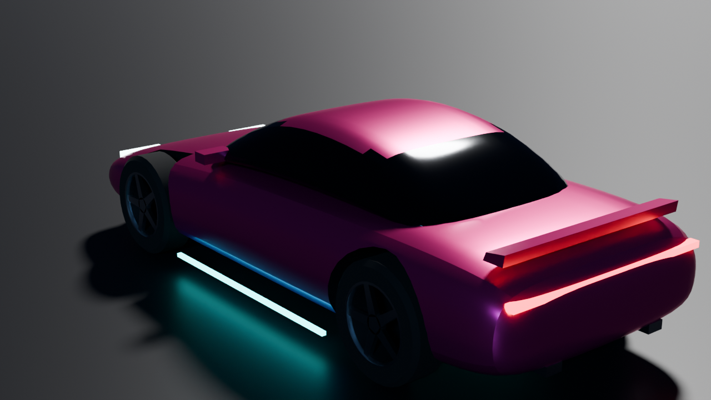
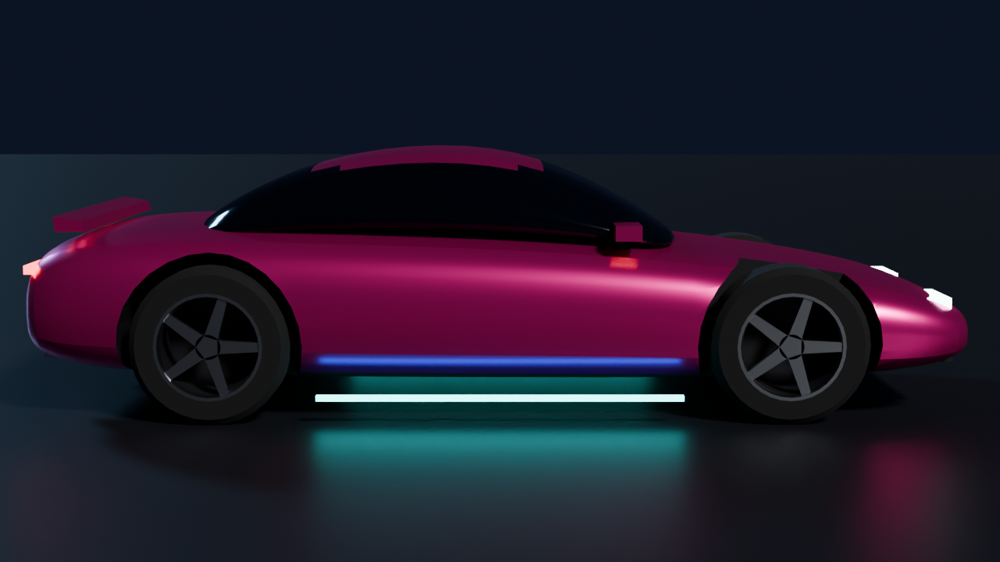
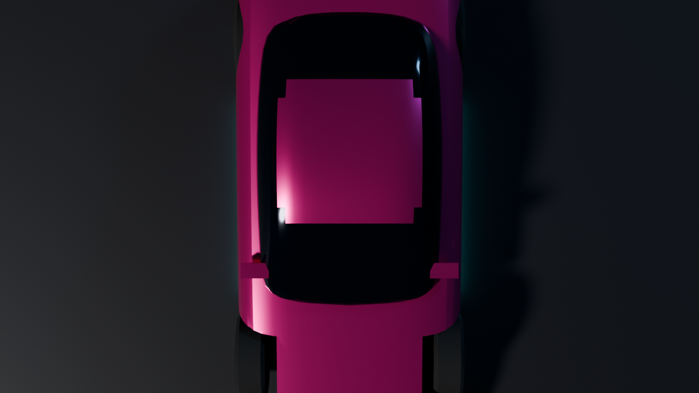
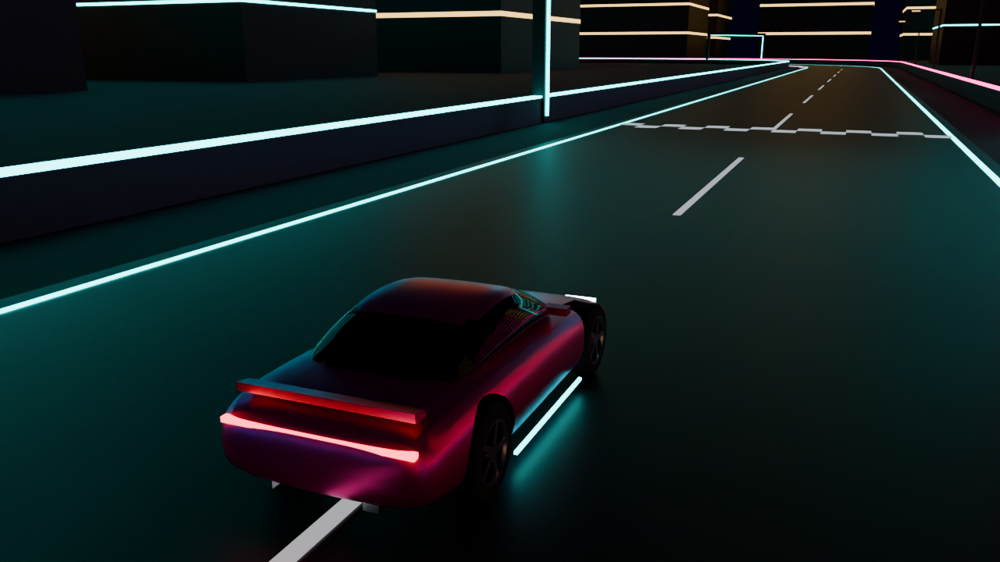
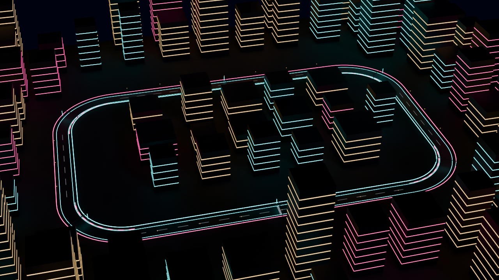
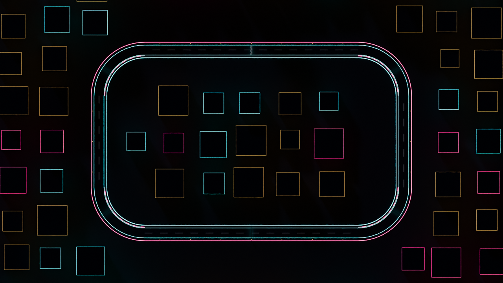
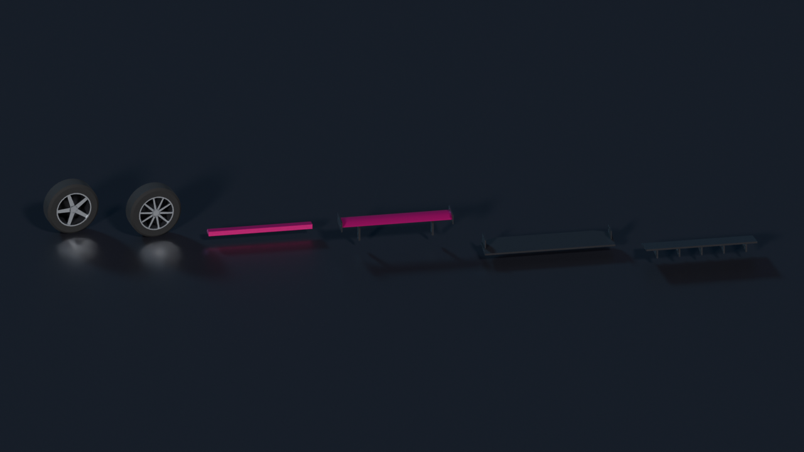

# Art pipeline: Blender → Unreal

The visuals for the first playable are generated by scripts in `blender/` and imported into Unreal
by `unreal/MidnightReign/Scripts/setup_visuals.py`. Hand-modelled art can replace any generated
asset later, as long as it follows the conventions below.

## Previews

Rendered in Blender (Cycles). Unreal's lighting and materials will look different; the shapes,
proportions and layout are what carries over.

| | |
|---|---|
|  |  |
|  |  |
|  |  |
|  |  |

## What exists

| Asset | File | Notes |
|---|---|---|
| Solaris GT (starter car) | `assets/export/SK_SolarisGT.fbx` | Original fictional coupe, about 7,800 triangles, 4.41 × 1.86 × 1.23 m |
| Wheels × 2 | `parts/SM_Wheel_FiveSpoke.fbx`, `SM_Wheel_Turbine.fbx` | Origin at the axle |
| Spoilers × 2 | `parts/SM_Spoiler_Lip.fbx`, `SM_Spoiler_Wing.fbx` | Origin at the boot-lid mount |
| Bumper add-ons | `parts/SM_FrontBumper_Splitter.fbx`, `SM_RearBumper_Diffuser.fbx` | Origin at the bumper's lower edge |
| Test block | `track/SM_Track_*.fbx`, `SM_Checkpoint_Arch.fbx` | 1.18 km loop, 14 m road, walls, 88 block-out buildings |
| Data | `solaris_gt.json`, `parts.json`, `track_layout.json`, `materials.json` | Read by the Unreal script; positions already in Unreal coordinates |

These are development-quality block-outs meant to make the game playable and set the look. They are
original work (no real makes or models) and safe to ship or replace.

## Conventions

- **Units:** 1 Blender unit = 1 cm (scene unit scale 0.01). FBX files import at scale 1.0 and the
  skeleton has no scaled root, which Chaos Vehicles requires.
- **Axes:** cars face **+X**, Z up. Blender's +Y is the car's left; Unreal flips Y, so left is −Y
  there. The manifests already contain Unreal coordinates.
- **Vehicle skeleton:** armature object named `Armature` (Unreal drops it), bones `Root`,
  `Phys_Wheel_FL`, `Phys_Wheel_FR`, `Phys_Wheel_BL`, `Phys_Wheel_BR`. Wheel bones sit at the wheel
  centres. Every vertex is skinned to exactly one bone with weight 1.
- **Ground contact:** tyres touch z = 0; the car is centred on the origin.
- **Materials:** slot names are `M_MR_*` (Paint, Glass, Trim, Tire, Rim, LightFront, LightRear,
  NeonCyan, NeonPink, Asphalt, …). Unreal assigns the instance `MI_MR_*` of the same name, so paint
  colour or neon colour changes are a material-instance change, not a re-export.
- **Parts:** a part's origin is its attach point. Spoilers attach at the car's `spoiler` socket,
  bumper add-ons at `front_bumper` / `rear_bumper`, wheels at the wheel bones.
- **Collision:** scenery uses its render triangles ("complex as simple"); lane markings have none.
  The car uses its physics asset.
- **Budgets (checked by tests):** car under 20,000 triangles, a part under 3,000, a track mesh
  under 30,000.
- **Palette:** asphalt `#19191E`, neon cyan `#00FFFF`, neon pink `#FF1493`, from the prototype.

## Adding a car

Copy `blender/specs/solaris_gt.json`, change the body/cabin sections, wheelbase, wheel sizes and
colours, then run `python3 blender/build_vehicle.py blender/specs/<new>.json`. Keep wheel sizes in
step with the wheel classes used by that car's tuning asset.

## Tests

`pytest blender/tests` re-imports every exported FBX and checks units, bone names and positions
against the C++ defaults, wheel radius, car size and orientation, rigid skinning, material names,
triangle budgets, part origins, the track layout and that nothing is built on the road.
